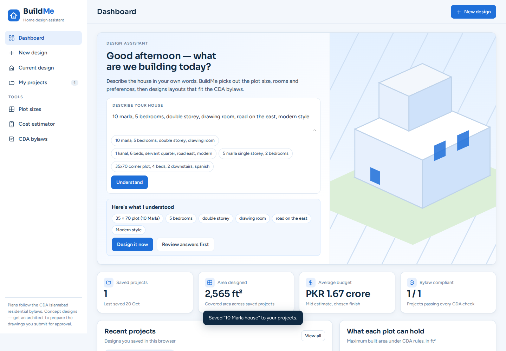
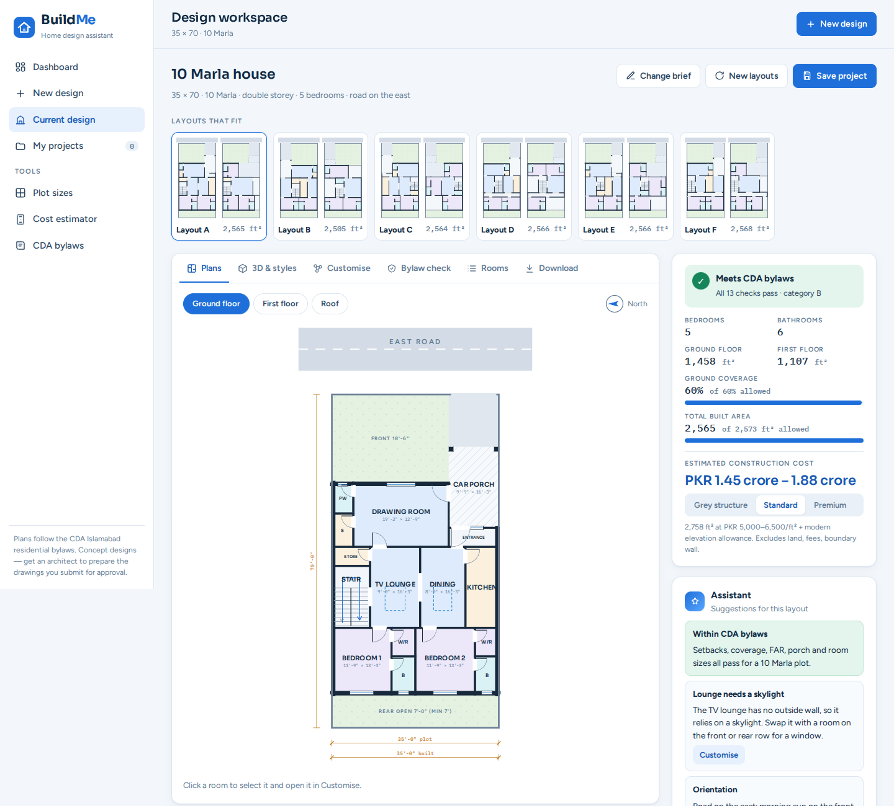
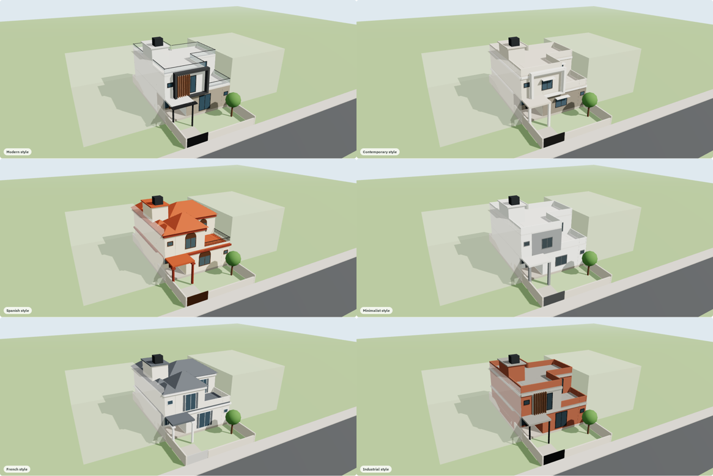

# BuildMe

**A home design assistant for plots across Pakistan.** Describe the house you want, or answer four quick questions. Pick where the plot is: CDA, RDA, LDA, FDA, GDA, MDA, Punjab TMAs, SBCA/KDA Karachi, PDA/KP, QDA/Balochistan, DHA (Islamabad–Rawalpindi, Lahore, Karachi) or Bahria Town (Rawalpindi–Islamabad, Lahore, Karachi). BuildMe then designs ground-floor, first-floor and roof plans that follow that authority's bylaws, builds a live 3D model in common Pakistani elevation styles, estimates construction cost, and exports a PDF report, CAD drawings and a 3D model. It runs entirely in the browser: no account, no server, and no AI model.



## The app

| Screen | What it's for |
|---|---|
| **Dashboard** | Describe the house in plain words, for example *"10 marla, 5 bedrooms, double storey, drawing room, road east, modern"*. BuildMe reads the plot, rooms and preferences from the text and designs straight away. Also shows your saved projects, totals, and a chart of what each plot size can hold under CDA rules. |
| **New design** | Four guided steps: location (building authority) and plot (standard sizes for that location or custom, road side, corner), house (floors, bedrooms, porch, front lawn or back yard), rooms (drawing, dining, servant quarter, dressing), and review, with an override for society bylaws. |
| **Design workspace** | Up to six layouts. Tabs for **Plans** (ground, first, roof), **3D & styles**, **Customise** (drag-and-drop room editor), **Bylaw check**, **Rooms** and **Download**. A side panel shows compliance, areas and cost, plus **Assistant** suggestions for the layout. |
| **My projects** | Saved designs with search, open, duplicate and delete. Stored in your browser. |
| **Plot sizes** | One ready plan for every standard plot, from 4 Marla to 2 Kanal. |
| **Cost estimator** | A quick budget for any plot, number of floors, style and covered area, at three finish levels. |
| **Bylaws** | The rules for each location, plot by plot, with sources and how reliable each rule set is. |
| **Interiors** | After you lock a layout: a furnished floor plan and a realistic 3D editor for each room (cut-away and walk-in eye-level views, curtains, doors, false ceilings, lights, switches). Drag, rotate, swap styles, add or remove furniture, set the room purpose, and pick floor finishes and wall colours. Each room has a dimensioned plan with clearances, four wall elevations, a ceiling and lighting plan, an electrical layout, a flooring layout, specifications and a priced BOQ. Ends with a room-by-room **design package** (PDF + ZIP with SVG drawings, renders, boq.csv, a furnished GLB model and JSON). |
| **Help & FAQ** | Searchable answers about plots, bylaws, layouts, costs and files, grouped by topic, plus a table of how many bedrooms fit on each plot. |

**Mimar**, BuildMe's cartoon architect guide, sits in the corner of every screen with tips for that screen. When a brief can't be designed, he explains which row didn't fit and offers one-click fixes (double storey, one bedroom fewer, no drawing room…). When BuildMe adjusts a brief to make it fit, a note says what changed and why. Most screens also have a **Quick answers** panel.



## What's inside

- **Bylaws for 16 authorities** (`src/authorities.js`). Setbacks, coverage, FAR (or first-floor share), mumty limits, storeys and porch rules by plot band, plus each region's standard plot sizes. Sources: LDA Building & Zoning Regulations 2019 (adopted by RDA, FDA and GDA), Karachi Building & Town Planning Regulations 2002, KP Model Building Bye-laws 2017, Balochistan Building Control & Town Planning Rules 2022, DHA Lahore Regulations 2026 and DHA Karachi Bylaws 2020. Each set is marked *official*, *secondary* (DHA Islamabad–Rawalpindi, Bahria Town, RDA) or *assumed* (MDA, TMAs).
- **Interiors** (`src/interior.js`, `src/interior3d.js`). Rule-based furniture layouts for every room type: walls ranked by doors and windows, door swing kept clear, tall pieces kept off windows, galley aisles of at least 3'-6", and a space-resolution pass that re-seats or swaps any piece the walkway check can't reach. There is a three.js room editor with a cut-away view, and a package builder that prices furniture, flooring and paint at 2026 PKR ranges in four themes (Modern, Classic, Minimal, Traditional).
- **CDA bylaw engine.** Implements the *Islamabad Residential Sectors Zoning (Building Control) Regulation 1993*: Schedule A setbacks, coverage, FAR and storeys, Schedule B stair tower, cl. 10 servant room, cl. 12.06 car porch, and Annex 1 minimum room sizes. Rear open space follows current practice: 5 ft up to 5 marla, 7 ft below 1 kanal, 10 ft from 1 kanal. Details in [docs/bylaws.md](docs/bylaws.md).
- **Always a plan when one is possible.** If the full brief doesn't fit, BuildMe relaxes it gently, in a fixed order: move a bedroom between floors, then dressing rooms, separate dining, drawing room, second car, optional servant room, and bedrooms last. It ranks every attempt against the original brief and lists each change. A typology sweep (`tests/typologies.test.mjs`) checks every standard plot, single and double storey, with 2, 4 and 6 bedrooms.
- **Deterministic layouts.** A plan is realised from an editable scheme: the rooms in each row, and how deep each row is. The same scheme always gives the same plan. Edits that would break a bylaw or leave a room unreachable are refused with a reason.
- **Design assistant.** Rule-based throughout. It reads a plain-language brief, then suggests improvements for each layout: unused floor area, rooms without windows, sun orientation by road side, bylaw notes.
- **3D and styles.** A live three.js model built from the plan, in seven styles: Massing, Modern, Contemporary, Spanish, Minimalist, French and Industrial.
- **Cost.** Covered area × 2026 Islamabad rates: grey structure PKR 2,800–3,800/ft², standard finish 5,000–6,500, premium finish 6,500–9,000. A small allowance is added depending on the elevation style.
- **Exports.**
  - PDF report: summary, plans, style renders, room schedule, bylaw check, cost breakdown.
  - DXF per floor (AutoCAD R12, inches, layered).
  - GLB 3D model.
  - PNG images and JSON plan data.
  - Or everything together as one ZIP.



## Run locally

```bash
npm run build     # → dist/index.html + dist/favicon.svg (the whole app)
npm test          # engine + typology tests: every plot, floors and bedroom count must give a CDA-compliant plan
npx serve dist    # or open dist/index.html directly
```

Node 18+ is needed only to build and test. At runtime the page loads three.js r128, jsPDF 2.5.1 and JSZip 3.10.1 from public CDNs.

## Deploy on Cloudflare

BuildMe is a static site, served as a Cloudflare Worker with static assets (`wrangler.jsonc`).

**From your computer:**
```bash
npx wrangler login     # opens the browser once to authorise your Cloudflare account
npm run deploy         # builds and deploys → https://buildme.<your-subdomain>.workers.dev
```

**Live site:** https://buildme-ail.pages.dev (Cloudflare Pages, direct upload). To publish an update, run `npm run build` and upload the `dist/` folder (or a zip of it) as a new deployment of the `buildme` Pages project in the Cloudflare dashboard.

**Without any tools:** in the Cloudflare dashboard, go to *Workers & Pages → Create → Pages → Upload assets*, name the project `buildme`, and drop in the `dist` folder.

To use your own domain, open *Workers & Pages → buildme → Settings → Domains & Routes*.

## Project layout

```
src/
  engine.js      CDA rules, programme → scheme, layout, doors/windows, scoring, bylaw checks, edits
  render.js      SVG plans, roof plan, bubble diagram
  model3d.js     three.js massing model, elevation styles, renders, GLB export
  export.js      cost model, DXF writer, PDF report, print palette
  authorities.js building authorities: rule bands, plot sizes, sources, brief-parser hints
  interior.js    furniture catalogue, room geometry, furniture layouts, 2D furniture plans, budgets
  interior-detail.js  room drawings (plan, elevations, RCP, electrical, flooring), specifications, BOQ
  interior3d.js  realistic 3D room editor, furnished-house GLB, interior design package (PDF + ZIP)
  help.js        Mimar (SVG guide), FAQ library, quick-answer cards, Help page, animated pop-ups and toasts
  app.js         app shell: dashboard, brief parser, questions, workspace, projects, tools, downloads
  template.html  markup and design system; the build inlines the scripts
scripts/build.mjs   builds dist/ (and artifact/ for claude.ai)
tests/engine.test.mjs, tests/typologies.test.mjs, tests/authorities.test.mjs
wrangler.jsonc      Cloudflare deployment
docs/               bylaws, architecture, screenshots
```

## Limits

- Concept designs only. A licensed architect must prepare drawings for CDA approval.
- Bylaws come from the published regulations where they could be read, otherwise from secondary summaries. Later amendments may differ, so confirm with the authority, or enter your own numbers under "My society has different bylaws" on the review step. BuildMe designs up to two storeys.
- Furniture sizes and PKR price ranges are typical 2026 market values, not quotations.
- CAD export is DXF, because a browser can't write DWG. Open the DXF in AutoCAD, BricsCAD or LibreCAD and *Save As → DWG*.
- Projects are saved in the browser you used: they don't sync across devices.

## Licence

Copyright © 2026 Ahmad Sohail. All rights reserved. See [LICENSE](LICENSE). Third-party libraries keep their own licences; see [NOTICE](NOTICE).
