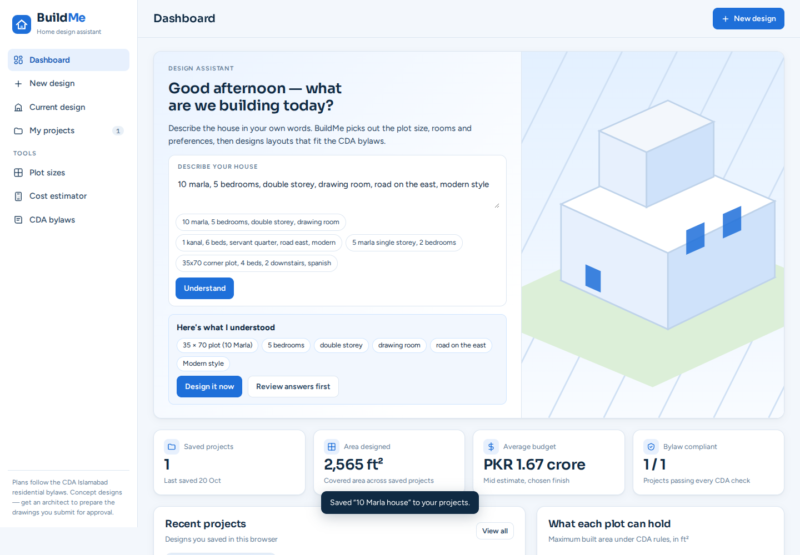
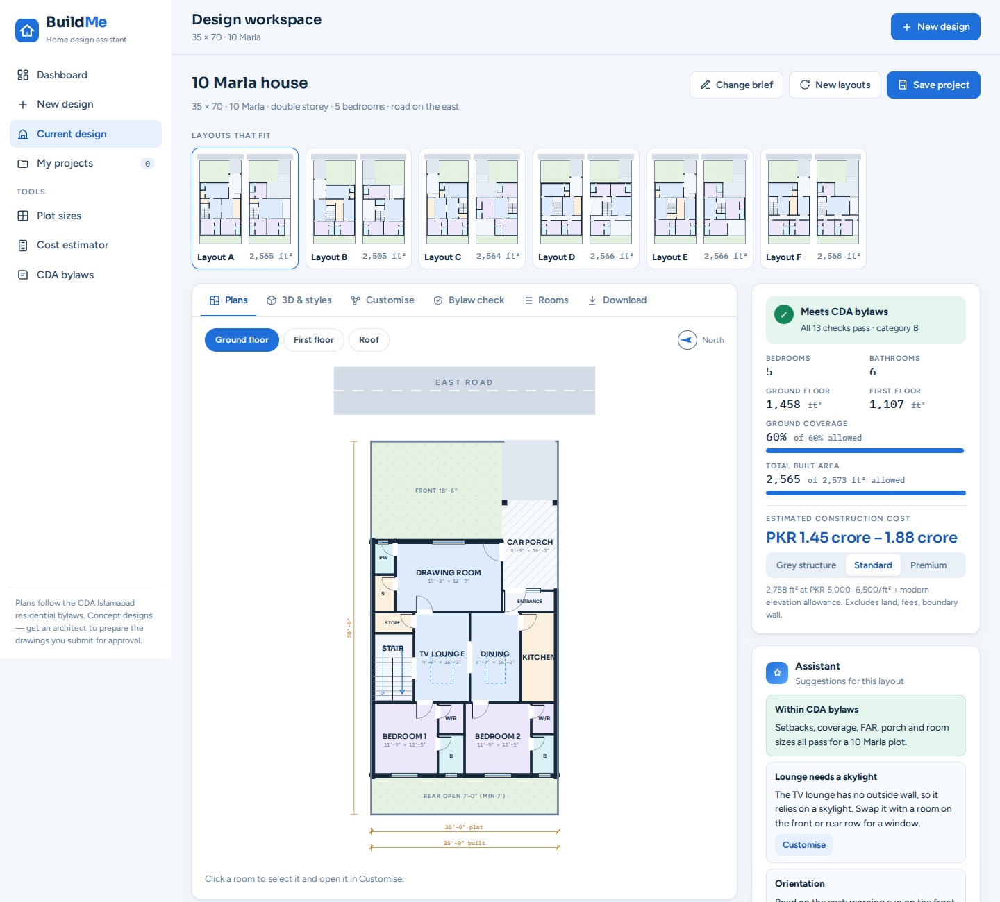
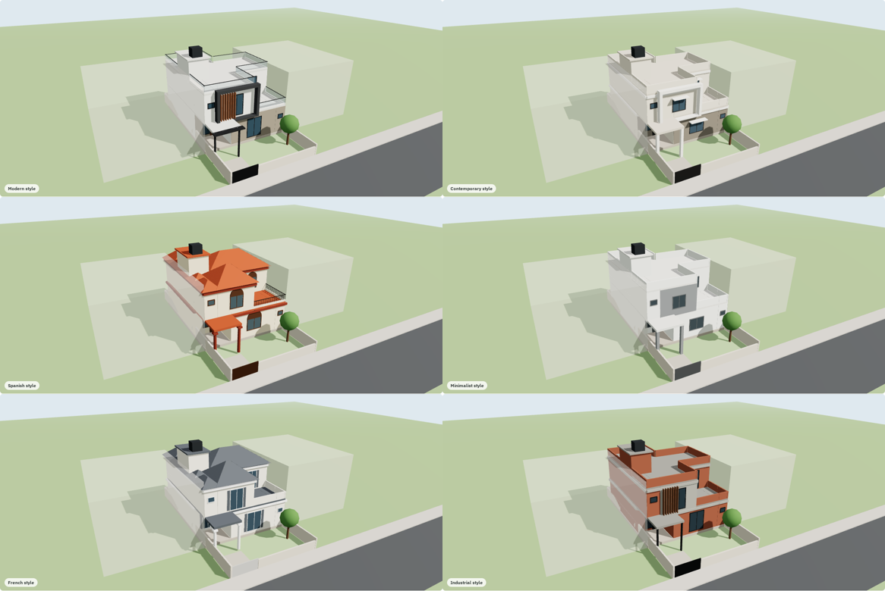

# BuildMe

**A home design assistant for Islamabad plots.** Describe the house you want, or answer four quick questions. BuildMe then designs ground-floor, first-floor and roof plans that follow the CDA residential bylaws, builds a live 3D model in common Pakistani elevation styles, estimates construction cost, and exports a PDF report, CAD drawings and a 3D model. It runs entirely in the browser: no account, no server, and no AI model.



## The app

| Screen | What it's for |
|---|---|
| **Dashboard** | Describe the house in plain words, for example *"10 marla, 5 bedrooms, double storey, drawing room, road east, modern"*. BuildMe reads the plot, rooms and preferences from the text and designs straight away. Also shows your saved projects, totals, and a chart of what each plot size can hold under CDA rules. |
| **New design** | Four guided steps: plot (standard or custom, road side, corner), house (floors, bedrooms, porch, front lawn or back yard), rooms (drawing, dining, servant quarter, dressing), and review, with an override for society bylaws. |
| **Design workspace** | Up to six layouts. Tabs for **Plans** (ground, first, roof), **3D & styles**, **Customise** (drag-and-drop room editor), **Bylaw check**, **Rooms** and **Download**. A side panel shows compliance, areas and cost, plus **Assistant** suggestions for the layout. |
| **My projects** | Saved designs with search, open, duplicate and delete. Stored in your browser. |
| **Plot sizes** | One ready plan for every standard plot, from 4 Marla to 2 Kanal. |
| **Cost estimator** | A quick budget for any plot, number of floors, style and covered area, at three finish levels. |
| **CDA bylaws** | The rules BuildMe applies and where they come from. |



## What's inside

- **CDA bylaw engine.** Implements the *Islamabad Residential Sectors Zoning (Building Control) Regulation 1993*: Schedule A setbacks, coverage, FAR and storeys, Schedule B stair tower, cl. 10 servant room, cl. 12.06 car porch, and Annex 1 minimum room sizes. Rear open space follows current practice: 5 ft up to 5 marla, 7 ft below 1 kanal, 10 ft from 1 kanal. Details in [docs/bylaws.md](docs/bylaws.md).
- **Deterministic layouts.** A plan is realised from an editable scheme: the rooms in each row, and how deep each row is. The same scheme always gives the same plan. Edits that would break a bylaw or leave a room unreachable are refused with a reason.
- **Design assistant.** Rule-based throughout. It reads a plain-language brief, then suggests improvements for each layout: unused floor area, rooms without windows, sun orientation by road side, bylaw notes.
- **3D and styles.** A live three.js model built from the plan, in seven styles: Massing, Modern, Contemporary, Spanish, Minimalist, French and Industrial.
- **Cost.** Covered area × 2026 Islamabad rates: grey structure PKR 2,800–3,800/ft², standard finish 5,000–6,500, premium finish 6,500–9,000. A small allowance is added depending on the elevation style.
- **Exports.**
  - PDF report: summary, plans, style renders, room schedule, bylaw check, cost breakdown.
  - DXF per floor (AutoCAD R12, inches, layered).
  - GLB 3D model.
  - PNG images and JSON plan data.
  - Or everything together as one ZIP.



## Run locally

```bash
npm run build     # → dist/index.html + dist/favicon.svg (the whole app)
npm test          # engine tests: every standard plot must pass the CDA bylaw check
npx serve dist    # or open dist/index.html directly
```

Node 18+ is needed only to build and test. At runtime the page loads three.js r128, jsPDF 2.5.1 and JSZip 3.10.1 from public CDNs.

## Deploy on Cloudflare

BuildMe is a static site, served as a Cloudflare Worker with static assets (`wrangler.jsonc`).

**From your computer:**
```bash
npx wrangler login     # opens the browser once to authorise your Cloudflare account
npm run deploy         # builds and deploys → https://buildme.<your-subdomain>.workers.dev
```

**Live site:** https://buildme-ail.pages.dev (Cloudflare Pages, direct upload). To publish an update, run `npm run build` and upload the `dist/` folder (or a zip of it) as a new deployment of the `buildme` Pages project in the Cloudflare dashboard.

**Without any tools:** in the Cloudflare dashboard, go to *Workers & Pages → Create → Pages → Upload assets*, name the project `buildme`, and drop in the `dist` folder.

To use your own domain, open *Workers & Pages → buildme → Settings → Domains & Routes*.

## Project layout

```
src/
  engine.js      CDA rules, programme → scheme, layout, doors/windows, scoring, bylaw checks, edits
  render.js      SVG plans, roof plan, bubble diagram
  model3d.js     three.js massing model, elevation styles, renders, GLB export
  export.js      cost model, DXF writer, PDF report, print palette
  app.js         app shell: dashboard, brief parser, questions, workspace, projects, tools, downloads
  template.html  markup and design system; the build inlines the scripts
scripts/build.mjs   builds dist/ (and artifact/ for claude.ai)
tests/engine.test.mjs
wrangler.jsonc      Cloudflare deployment
docs/               bylaws, architecture, screenshots
```

## Limits

- Concept designs only. A licensed architect must prepare drawings for CDA approval.
- The bylaws are the CDA 1993 regulation plus current rear-setback practice. Societies (DHA, Bahria, B-17 and others) and later notifications may differ; use "My society has different bylaws" on the review step.
- CAD export is DXF, because a browser can't write DWG. Open the DXF in AutoCAD, BricsCAD or LibreCAD and *Save As → DWG*.
- Projects are saved in the browser you used: they don't sync across devices.

## Licence

Copyright © 2026 Ahmad Sohail. All rights reserved. See [LICENSE](LICENSE). Third-party libraries keep their own licences; see [NOTICE](NOTICE).
